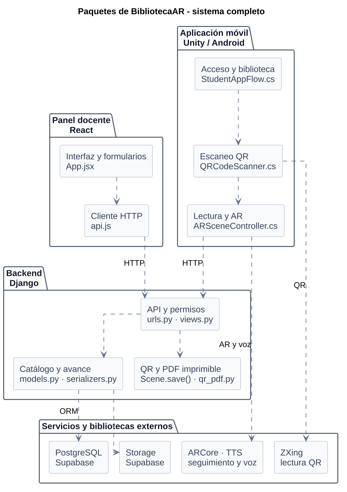
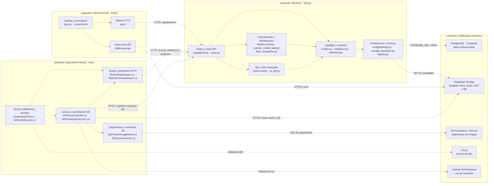

# Diagrama de paquetes de BibliotecaAR

**Para pegar una sola figura en la tesis**, usa la versión vertical del sistema completo: [PNG de alta resolución](diagrama-paquetes-sistema-vertical.png), [SVG nítido a cualquier tamaño](diagrama-paquetes-sistema-vertical.svg) o [PlantUML editable](diagrama-paquetes-sistema-vertical.puml). Incluye el panel React, la app Unity, la API Django, PostgreSQL, Storage y las bibliotecas Android. Su disposición está pensada para una página vertical; en Word, insértala con «En línea con el texto», fija un ancho aproximado de **14 cm** y conserva la proporción. Quedará cerca de 20 cm de alto, dejando espacio para el pie de figura.

El [detalle de paquetes de la app móvil en PlantUML](diagrama-paquetes-app-movil.puml) también se reorganizó verticalmente. Tiene [PNG](diagrama-paquetes-app-movil.png) y [SVG](diagrama-paquetes-app-movil.svg). Úsalo si necesitas explicar específicamente los módulos internos de Unity; la figura anterior es la recomendada para resumir el proyecto completo.

En esta vista, Django se dibuja fuera de la app móvil porque es otro repositorio del mismo proyecto. La conexión de Unity llega a la API de Django; **Unity no se conecta directamente a PostgreSQL**.

Este es el diagrama de paquetes **general** del proyecto. Los tres contenedores de código corresponden a los tres repositorios; el cuarto reúne servicios y bibliotecas **externos** para mostrar conexiones como la de Django con la base de datos. Los bloques internos agrupan código con una responsabilidad común. Las flechas discontinuas indican que el paquete de origen **depende** del destino. No representan el orden temporal de uso de la aplicación.

## Lectura del diagrama

1. El **panel docente** usa `src/api.js` para crear y editar libros, capítulos y estudiantes mediante la API. La vista previa GLB funciona en el navegador, pero la experiencia AR se ejecuta en Unity.
2. El **backend** recibe las solicitudes, aplica autenticación y permisos, valida los datos y consulta el catálogo. `Scene` representa un capítulo; genera su identificador QR y el PNG. `qr_pdf.py` genera la hoja lista para imprimir con la medida física guardada.
3. La **app móvil** permite acceso por código o rostro, muestra la biblioteca y escanea el QR. `ARSceneController` consulta el capítulo y coordina texto, audio, modelo y seguimiento de imagen. La sesión y las peticiones se gestionan en los scripts de acceso docente/estudiantil y en el propio controlador AR.
4. La dependencia entre repositorios es **HTTP hacia Django**. Solo Django usa la base de datos mediante su ORM. El backend guarda los archivos en Supabase Storage cuando está configurado; React y Unity pueden descargar los recursos desde las URLs que devuelve la API.
5. Las bibliotecas móviles externas tienen funciones distintas: **ZXing** lee el contenido del QR, **AR Foundation/ARCore** sigue su imagen en el espacio y **Android TextToSpeech** lee la narración cuando no hay audio grabado.

## Correspondencia con los repositorios

| Paquete principal | Repositorio | Código representativo |
| --- | --- | --- |
| Panel docente | [`BiblitoecaAR-fronted`](https://github.com/AlejandroPhoccoTapia/BiblitoecaAR-fronted) | `src/App.jsx`, `src/components/`, `src/api.js`, `src/lib/forms.js` |
| Backend | [`BibliotecaAR-backend`](https://github.com/AlejandroPhoccoTapia/BibliotecaAR-backend) | `catalog/`, `config/` |
| Aplicación Android | [`BibliotecaAR`](https://github.com/AlejandroPhoccoTapia/BibliotecaAR) | `Assets/Scripts/`, `Assets/Scenes/` |

La base de datos y el almacenamiento aparecen como **servicios externos**, no como paquetes internos del código. En desarrollo se usa SQLite y media local; PostgreSQL y Supabase Storage representan el despliegue configurado. La autenticación de docentes y estudiantes se implementa en **Django**: el proyecto no usa Supabase Auth ni Google Identity. Vercel y Render alojan aplicaciones, por lo que su ubicación física corresponde a un **diagrama de despliegue**, no a estas dependencias de paquetes.

Para una explicación general de la arquitectura en la tesis, **la figura vertical del sistema completo es suficiente**. El detalle de Unity es opcional; úsalo si el texto necesita explicar sus paquetes internos y conexiones externas. No hace falta insertar ambas figuras si repetirían la misma explicación en el documento.
