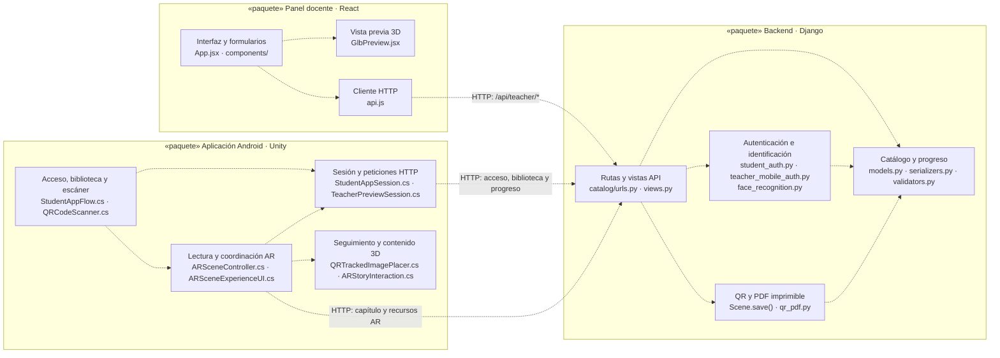

# Diagrama de paquetes de BibliotecaAR

Este es el diagrama de paquetes **general** del proyecto. Los tres contenedores grandes corresponden a los tres repositorios; los bloques internos agrupan código con una responsabilidad común. Las flechas discontinuas indican que el paquete de origen **depende** del paquete al que apuntan. No representan el orden temporal de uso de la aplicación.

## Lectura del diagrama

1. El **panel docente** usa `src/api.js` para crear y editar libros, capítulos y estudiantes mediante la API. La vista previa GLB funciona en el navegador, pero la experiencia AR se ejecuta en Unity.
2. El **backend** recibe las solicitudes, aplica autenticación y permisos, valida los datos y consulta el catálogo. `Scene` representa un capítulo; genera su identificador QR y el PNG. `qr_pdf.py` genera la hoja lista para imprimir con la medida física guardada.
3. La **app móvil** permite acceso por código o rostro, muestra la biblioteca y escanea el QR. `ARSceneController` consulta el capítulo y coordina texto, audio, modelo y seguimiento de imagen. La sesión y las peticiones se gestionan en los scripts de acceso docente/estudiantil y en el propio controlador AR.
4. La dependencia entre repositorios es **HTTP hacia Django**. Ni React ni Unity consultan directamente PostgreSQL/SQLite. Los archivos de audio, modelos e imágenes se obtienen mediante las URLs que devuelve la API.

## Correspondencia con los repositorios

| Paquete principal | Repositorio | Código representativo |
| --- | --- | --- |
| Panel docente | [`BiblitoecaAR-fronted`](https://github.com/AlejandroPhoccoTapia/BiblitoecaAR-fronted) | `src/App.jsx`, `src/components/`, `src/api.js`, `src/lib/forms.js` |
| Backend | [`BibliotecaAR-backend`](https://github.com/AlejandroPhoccoTapia/BibliotecaAR-backend) | `catalog/`, `config/` |
| Aplicación Android | [`BibliotecaAR`](https://github.com/AlejandroPhoccoTapia/BibliotecaAR) | `Assets/Scripts/`, `Assets/Scenes/` |

La base de datos y el almacenamiento de archivos **no se dibujan como paquetes de código**: son infraestructura. En desarrollo se usa SQLite y media local; el despliegue está configurado para PostgreSQL y almacenamiento de Supabase. Si necesitas representar Vercel, Render, Supabase y el teléfono como máquinas o servicios, corresponde hacer un **diagrama de despliegue** aparte.

Para una explicación general de la arquitectura en la tesis, **este único diagrama de paquetes es suficiente**. Un segundo diagrama interno de Django o Unity solo aporta valor si el documento exige describir sus dependencias con más detalle; no conviene multiplicar diagramas que repitan las mismas relaciones.
